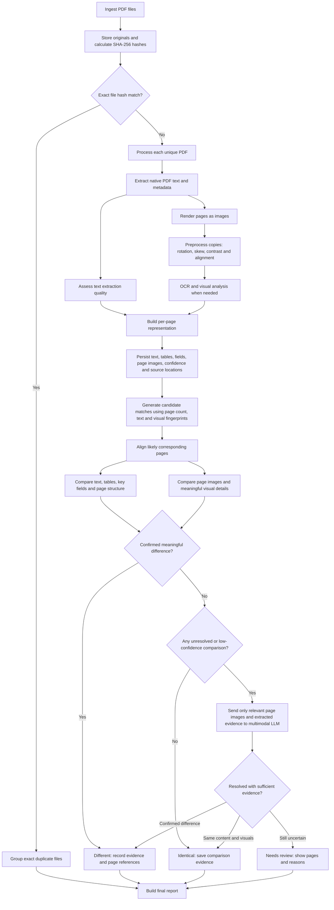

# PDF Comparison Agent — Architecture Flow

## Goal

Determine whether 30 PDFs contain the same meaningful information, even when they differ in scan quality, alignment, orientation, or file format.

The system must return one of three outcomes:

- **Identical** — no meaningful differences found after verification.
- **Different** — at least one meaningful difference is confirmed.
- **Needs review** — extraction or comparison is inconclusive.

## Flow diagram

## Stage responsibilities

| Stage | Responsibility | Output |
|---|---|---|
| Ingestion | Store each original and calculate SHA-256 | File inventory and exact duplicate groups |
| Extraction | Extract embedded text, metadata and tables | Initial text and metadata |
| Rendering | Convert pages into images | Page images |
| Preprocessing | Correct rotation/skew and improve comparability without altering originals | Normalized comparison images |
| OCR and visual analysis | Recover text from scanned pages and identify visual content | OCR text and visual observations |
| Representation | Store content with page numbers, bounding boxes where available, and confidence | Searchable, auditable page records |
| Candidate matching | Find likely matching documents/pages without excluding uncertain candidates | Candidate pairs/groups |
| Comparison | Compare text, values, tables, structure and visuals | Difference list and confidence flags |
| AI escalation | Review only unresolved page pairs with a multimodal model; optionally use JEV for a bounded structured decision | Explanation or unresolved status |
| Reporting | Present outcome, differences and evidence | Identical / Different / Needs review report |

## Decision rules

1. **Exact file hashes match:** The files are byte-for-byte identical; group them without AI.
2. **A meaningful value or page difference is verified:** Mark the pair as **Different**.
3. **Text appears identical but visual details may differ:** Compare the original page images and escalate uncertain cases.
4. **Extraction confidence is low or pages cannot be aligned:** Do not assume the documents match; mark **Needs review** unless further analysis resolves it.
5. **Declare Identical only after all required pages and relevant content have been checked.**

## Model responsibilities

- **Python comparison logic:** Performs exact comparisons and records evidence.
- **OCR / document extraction model:** Extracts content from pages where native PDF text is unavailable or insufficient.
- **Multimodal LLM:** Examines selected page pairs when visual or semantic differences remain unresolved.
- **JEV (optional):** Classifies structured comparison evidence into a constrained decision. It should not override verified evidence, and its image capabilities should be validated on the actual document set before relying on them.

## Implementation notes

- Process each PDF once and persist the results so retries do not repeat extraction.
- Keep original page images alongside normalized copies; preprocessing can erase faint marks.
- A perceptual hash or embedding is useful for finding candidate matches, not for proving identity.
- Preserve source page and location for extracted fields so reviewers can verify them.
- Compare every relevant candidate pair or use a clustering method that preserves uncertain relationships. Do not silently discard possible matches because a scan looks different.
- Evaluate with known examples: exact duplicates, altered numbers, missing pages, rotations, low-quality scans, stamps, signatures, handwriting, and different layouts.
